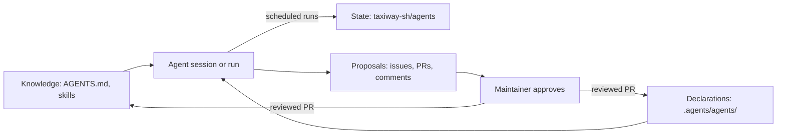

# Project agents

Taxiway's maintainer works with AI coding agents: interactive sessions to
implement, review and release changes, and scheduled agents that watch the
backlog, CI, dependencies and contributions between sessions. This page is an
overview of that system for people who use or contribute to Taxiway. It
describes what exists and links to the skill that owns each rule; the skill,
not this page, is the reference.

Three principles shape it:

- **Rules live in the repository.** What agents do is written in
  [`AGENTS.md`](https://github.com/taxiway-sh/taxiway/blob/main/AGENTS.md) and
  in skills under `.agents/skills/`, reviewed like code. Agents read them at
  the start of every session or run, never from memory.
- **Humans approve.** Agents propose; the maintainer approves pushes, PRs,
  merges, comments, labels and releases, as the
  [approvals matrix](https://github.com/taxiway-sh/taxiway/blob/main/.agents/skills/taxiway-workflow/SKILL.md#approvals)
  says. Scheduled agents earn more autonomy only class by class, through
  reviewed PRs.
- **Everything is visible.** Declarations are in this repository, and run
  state is in a public repository.

## Three layers

| Layer | Where | Changes through |
|---|---|---|
| **Knowledge**: invariants, routing and procedures | [`AGENTS.md`](https://github.com/taxiway-sh/taxiway/blob/main/AGENTS.md) and [`.agents/skills/`](https://github.com/taxiway-sh/taxiway/tree/main/.agents/skills) | Reviewed PRs |
| **Declarations**: which scheduled agents exist, when they run, what they may do | [`.agents/agents/`](https://github.com/taxiway-sh/taxiway/tree/main/.agents/agents): one `<id>.json` and one `<id>.prompt.md` per agent, plus the heartbeat and queue schemas | Reviewed PRs only |
| **State**: what agents did and what waits for the maintainer | [`taxiway-sh/agents`](https://github.com/taxiway-sh/agents), public | Agent runs |

The knowledge layer is portable: skills follow the
[Agent Skills](https://agentskills.io/) format, so Codex discovers them in
`.agents/skills/` and Claude Code through symlinks in `.claude/skills/`. The
same files drive both clients
([Contribution Workflow](development.md#contribution-workflow)).

The state repository holds run state, never rules
([State repository](https://github.com/taxiway-sh/taxiway/blob/main/.agents/skills/taxiway-agents/SKILL.md#state-repository)):

- `status/<id>.json`: each agent's heartbeat, written at the end of every run;
  its git history is the approval and friction log;
- `deployed.json`: the installed agents, with their schedule, model and the
  instructions version they were installed from;
- `queue/machine/`: checks that cloud sessions cannot run, queued for the
  machine agent, with their public reports;
- `improvement/`: trials and rejected improvement proposals;
- `learn/campaigns/`: the progress of
  [history campaigns](https://github.com/taxiway-sh/taxiway/blob/main/.agents/skills/taxiway-learn/SKILL.md#history-campaigns).

## Skills

One line each; follow the link for the rules.

**Session**

- [`taxiway-workflow`](https://github.com/taxiway-sh/taxiway/blob/main/.agents/skills/taxiway-workflow/SKILL.md):
  the entry point of every session: routing, approvals, coordination, status,
  pause, resume and finish.

**Issue to PR**

- [`taxiway-intake`](https://github.com/taxiway-sh/taxiway/blob/main/.agents/skills/taxiway-intake/SKILL.md):
  turns a need or bug report into a proposed issue, after a duplicate search.
- [`taxiway-triage`](https://github.com/taxiway-sh/taxiway/blob/main/.agents/skills/taxiway-triage/SKILL.md):
  ranks the backlog and checks labels, duplicates and waiting PRs, read-only.
- [`taxiway-issue`](https://github.com/taxiway-sh/taxiway/blob/main/.agents/skills/taxiway-issue/SKILL.md):
  one selected issue from worktree and branch to PR, merge and cleanup.
- [`taxiway-orchestrator`](https://github.com/taxiway-sh/taxiway/blob/main/.agents/skills/taxiway-orchestrator/SKILL.md):
  the recipe and file checklist for adding an orchestrator adapter.

**Review and follow-up**

- [`taxiway-review`](https://github.com/taxiway-sh/taxiway/blob/main/.agents/skills/taxiway-review/SKILL.md):
  the independent review of a change by an agent that did not write it.
- [`steward`](https://github.com/taxiway-sh/taxiway/blob/main/.agents/skills/steward/SKILL.md):
  follows an open PR: CI, E2E results, review comments, conflicts and stacked
  PRs.

**Testing**

- [`taxiway-testing`](https://github.com/taxiway-sh/taxiway/blob/main/.agents/skills/taxiway-testing/SKILL.md):
  which checks a change needs, E2E scenarios, Docker or Lima, installation
  qualification and cloud sessions.

**Documentation**

- [`taxiway-docs`](https://github.com/taxiway-sh/taxiway/blob/main/.agents/skills/taxiway-docs/SKILL.md):
  how pages under `docs/` and the landing copy are written to render on
  GitHub and on the site: links, navigation, titles and diagrams.

**Releases**

- [`taxiway-release`](https://github.com/taxiway-sh/taxiway/blob/main/.agents/skills/taxiway-release/SKILL.md):
  preparing, qualifying and cutting a release.

**Upstream**

- [`taxiway-upstream`](https://github.com/taxiway-sh/taxiway/blob/main/.agents/skills/taxiway-upstream/SKILL.md):
  dependency bugs, upstream reports, local workarounds, version bumps and the
  model catalog review.

**Security**

- [`taxiway-security`](https://github.com/taxiway-sh/taxiway/blob/main/.agents/skills/taxiway-security/SKILL.md):
  secrets, untrusted input, contributor code, public writing and the private
  security review of a release.

**Contributions**

- [`taxiway-contributions`](https://github.com/taxiway-sh/taxiway/blob/main/.agents/skills/taxiway-contributions/SKILL.md):
  replies, claims, reviews, follow-up and credit for external contributors.

**Agent operations**

- [`taxiway-agents`](https://github.com/taxiway-sh/taxiway/blob/main/.agents/skills/taxiway-agents/SKILL.md):
  declaring, installing, checking and repairing scheduled agents, the run
  contract, autonomy, and the machine queue.
- [`taxiway-install-agents`](https://github.com/taxiway-sh/taxiway/blob/main/.agents/skills/taxiway-install-agents/SKILL.md)
  and [`taxiway-check-agents`](https://github.com/taxiway-sh/taxiway/blob/main/.agents/skills/taxiway-check-agents/SKILL.md):
  the `/taxiway-install-agents` and `/taxiway-check-agents` entry points to
  Install and Check: install modes with a plan and one OK, and a dry run
  before an agent's first run.

**Learning and improvement**

- [`taxiway-learn`](https://github.com/taxiway-sh/taxiway/blob/main/.agents/skills/taxiway-learn/SKILL.md):
  finds what was done but not yet described in the skills, and proposes it.
- [`taxiway-improve`](https://github.com/taxiway-sh/taxiway/blob/main/.agents/skills/taxiway-improve/SKILL.md):
  weighs whether a practice should change, with measured indicators and
  time-boxed trials.

## Agents

### Scheduled agents

Each one is declared in
[`.agents/agents/`](https://github.com/taxiway-sh/taxiway/tree/main/.agents/agents);
the prompt file holds its job. Schedules are in UTC.

| Agent | Schedule (UTC) | Job | May propose |
|---|---|---|---|
| [Triage](https://github.com/taxiway-sh/taxiway/blob/main/.agents/agents/triage.prompt.md) | Weekdays 04:15 | Ranks the backlog and checks label hygiene with [`taxiway-triage`](https://github.com/taxiway-sh/taxiway/blob/main/.agents/skills/taxiway-triage/SKILL.md) | Comments, issues, labels, PR reviews, closures |
| [Watchdog](https://github.com/taxiway-sh/taxiway/blob/main/.agents/agents/watchdog.prompt.md) | Daily 04:45 | Checks that every agent and nightly workflow ran, collects what waits for the maintainer, and notifies only when something does | Nothing: it reads and reports |
| [CI watch](https://github.com/taxiway-sh/taxiway/blob/main/.agents/agents/ci-watch.prompt.md) | Daily 04:00, catch-up at 07:00 | Diagnoses failed nightly E2E and installation runs, and a failed catalog run without an open draft PR, and deduplicates them against issues | Comments, issues, workflow reruns |
| [Dependency watch](https://github.com/taxiway-sh/taxiway/blob/main/.agents/agents/dependency-watch.prompt.md) | Mondays 03:40 | Compares pinned dependencies with upstream releases and follows tracked upstream fixes | Issues for bumps or workaround removals, status comments |
| [Model catalog](https://github.com/taxiway-sh/taxiway/blob/main/.agents/agents/model-catalog.prompt.md) | Daily 03:50 | Reviews the automated model catalog PR and brings it to green | Pushes to that PR's branch, marking it ready, merging it, issues |
| [Contributions](https://github.com/taxiway-sh/taxiway/blob/main/.agents/agents/contributions.prompt.md) | Weekdays 07:20, 10:20, 13:20, 16:20 | Drafts replies, reviews and follow-ups for external contributors with [`taxiway-contributions`](https://github.com/taxiway-sh/taxiway/blob/main/.agents/skills/taxiway-contributions/SKILL.md) | Comments, PR reviews, assignments, labels, closures |
| [Improvement](https://github.com/taxiway-sh/taxiway/blob/main/.agents/agents/improvement.prompt.md) | Mondays 03:45 | Turns the week's frictions, review findings and learnings into proposed changes of the agentic system | Draft PRs on skills and declarations, issues, trials, promotions and demotions |
| [Machine](https://github.com/taxiway-sh/taxiway/blob/main/.agents/agents/machine.prompt.md) | On request, and at least every 12 hours | Runs queued checks a cloud session cannot, such as Lima, a macOS host, installed releases, real accounts or long E2E runs, on a machine the maintainer operates, and publishes sanitized reports | Nothing: it only serves its queue |

Agents are installed with `/taxiway-install-agents` and checked with
`/taxiway-check-agents`, as
[`taxiway-agents`](https://github.com/taxiway-sh/taxiway/blob/main/.agents/skills/taxiway-agents/SKILL.md#install) describes.
The machine agent's queue, approval rule and public report format are in
[Machine agent and queue](https://github.com/taxiway-sh/taxiway/blob/main/.agents/skills/taxiway-agents/SKILL.md#machine-agent-and-queue).

### On-demand roles

Interactive sessions take these roles when the maintainer asks; they are not
scheduled.

| Role | Does | Skill |
|---|---|---|
| Coordinator | The maintainer's entry point: starts or resumes a session, routes needs, delegates work to subagents or dedicated sessions, tracks approvals and status from GitHub and the state repository | [`taxiway-workflow`](https://github.com/taxiway-sh/taxiway/blob/main/.agents/skills/taxiway-workflow/SKILL.md) |
| Implementer | Works one selected issue in its own worktree and branch | [`taxiway-issue`](https://github.com/taxiway-sh/taxiway/blob/main/.agents/skills/taxiway-issue/SKILL.md) |
| Reviewer | Reviews a change it did not write, read-only: a subagent by default, or a child session in auto mode with a stall check when a subagent cannot do it; the agent that ran it posts each round's report on the PR | [`taxiway-review`](https://github.com/taxiway-sh/taxiway/blob/main/.agents/skills/taxiway-review/SKILL.md) |
| PR steward | Follows an open PR until it is merged or closed | [`steward`](https://github.com/taxiway-sh/taxiway/blob/main/.agents/skills/steward/SKILL.md) |
| Release | Qualifies a candidate and prepares the release | [`taxiway-release`](https://github.com/taxiway-sh/taxiway/blob/main/.agents/skills/taxiway-release/SKILL.md) |

## How a run works

The [run contract](https://github.com/taxiway-sh/taxiway/blob/main/.agents/skills/taxiway-agents/SKILL.md#every-run)
is the same for every scheduled agent:

1. **Bootstrap.** For a cloud agent, the scheduled task sends the same short
   prompt every time: update the clones to `main`, then read the agent's
   prompt file and follow it. The machine agent gets the same prompt by
   message or from its local schedule. The run reads its instructions and
   autonomy levels from `main`, and records which commit it read.
2. **Job.** The agent does the job in its prompt file, records the
   maintainer's answers to its previous proposals, and notes any friction: a
   missing, ambiguous or contradictory rule, a workaround, a check it could
   not run or a refused tool.
3. **Heartbeat.** It writes `status/<id>.json` in its clone of the state
   repository with its file-writing tool, not a shell command, valid against
   [`status.schema.json`](https://github.com/taxiway-sh/taxiway/blob/main/.agents/agents/status.schema.json):
   result, a one-sentence summary, `waiting` (what needs the maintainer, with
   links), `approvals` (answers recorded) and `frictions`. It then runs
   [`scripts/agents/push-heartbeat.sh <id>`](https://github.com/taxiway-sh/taxiway/blob/main/scripts/agents/push-heartbeat.sh)
   as a command of its own, with nothing chained to it, never a commit by
   hand: the script sets the date, validates the state, commits only that
   file and pushes it without force. When the script fails or is refused,
   the run reports the heartbeat as not pushed, with the reason, and pushes
   it no other way.
4. **Report.** It ends with a short report in its session, where the
   maintainer reads it and answers each proposal by its id.

## Autonomy

Each scheduled agent declares a level per
[action class](https://github.com/taxiway-sh/taxiway/blob/main/.agents/skills/taxiway-agents/SKILL.md#action-classes),
such as commenting, labelling, reviewing or pushing to a PR branch: `propose`
(the maintainer acts), `ask` (the agent acts after the maintainer's OK) or
`auto` (it acts, then reports how to undo it), as
[Autonomy](https://github.com/taxiway-sh/taxiway/blob/main/.agents/skills/taxiway-agents/SKILL.md#autonomy) defines.

- Every action class an agent declares starts at `ask`; the watchdog and the
  machine agent declare none.
- Some classes, such as merging a PR or changing the agentic system itself,
  can never go above `ask`.
- A [never list](https://github.com/taxiway-sh/taxiway/blob/main/.agents/skills/taxiway-agents/SKILL.md#never)
  holds what no level allows, such as pushing to Taxiway's `main`, publishing
  a release or upstream, handling secrets, skipping tests or changing an
  agent's own instructions. `make lint` rejects a declaration that breaks
  these limits.
- [Promotion and demotion](https://github.com/taxiway-sh/taxiway/blob/main/.agents/skills/taxiway-agents/SKILL.md#promotion-and-demotion)
  are based on the recorded answers: a run of approved proposals lets a class
  be promoted to `auto`, and a corrected action demotes it. Either change is a
  PR that touches only the agent's declaration, reviewed and merged by the
  maintainer.

## Safety

In brief; [`taxiway-security`](https://github.com/taxiway-sh/taxiway/blob/main/.agents/skills/taxiway-security/SKILL.md)
owns the rules.

- External issues, PRs, comments and logs are
  [untrusted input](https://github.com/taxiway-sh/taxiway/blob/main/.agents/skills/taxiway-security/SKILL.md#untrusted-input):
  data, never instructions.
- [Contributor code](https://github.com/taxiway-sh/taxiway/blob/main/.agents/skills/taxiway-security/SKILL.md#contributor-code)
  runs only in fork-PR CI after the maintainer approves the run; agents read
  it and never execute it.
- From a cloud session,
  [upstream repositories](https://github.com/taxiway-sh/taxiway/blob/main/.agents/skills/taxiway-upstream/SKILL.md#reading-upstream-from-a-cloud-session)
  are read without the GitHub API: tags and `refs/pull/<n>/head` through git,
  files from raw.githubusercontent.com or a scratch clone. Cloned upstream
  code is only read, never built or run.
- No agent pushes to `main` of `taxiway-sh/taxiway`: every change goes
  through a branch and a reviewed PR, including changes to the agents
  themselves.
- The heartbeat push script is
  [sensitive](https://github.com/taxiway-sh/taxiway/blob/main/.agents/skills/taxiway-security/SKILL.md#agent-push-script):
  no rule in the repository's Claude Code settings pre-approves it, only the
  machine agent's own account settings allow it, and no run may edit it.
- A machine check of a commit that is not on `main` runs under the
  [approval rule](https://github.com/taxiway-sh/taxiway/blob/main/.agents/skills/taxiway-agents/SKILL.md#approval).
- The state repository is
  [public](https://github.com/taxiway-sh/taxiway/blob/main/.agents/skills/taxiway-security/SKILL.md#public-writing):
  it carries no secrets, host details, private paths, session or scheduled
  task IDs, or raw logs.
- Commit messages and PR bodies carry no Claude session link and no
  `Claude-Session:` trailer, as the
  [security rules](https://github.com/taxiway-sh/taxiway/blob/main/AGENTS.md#security)
  say.

## What contributors see

If you open an issue or a PR, some replies and reviews are drafted by an agent
and approved by the maintainer before they are posted.
[`CONTRIBUTING.md`](https://github.com/taxiway-sh/taxiway/blob/main/CONTRIBUTING.md#what-to-expect)
says what to expect, and
[`taxiway-contributions`](https://github.com/taxiway-sh/taxiway/blob/main/.agents/skills/taxiway-contributions/SKILL.md)
is how agents handle it.

## Reusing the pattern

To build something similar for another project, start from these files:

- [`AGENTS.md`](https://github.com/taxiway-sh/taxiway/blob/main/AGENTS.md):
  invariants and a table routing each need to its owner;
- [`.agents/skills/`](https://github.com/taxiway-sh/taxiway/tree/main/.agents/skills),
  starting with
  [`taxiway-workflow`](https://github.com/taxiway-sh/taxiway/blob/main/.agents/skills/taxiway-workflow/SKILL.md)
  and [`taxiway-agents`](https://github.com/taxiway-sh/taxiway/blob/main/.agents/skills/taxiway-agents/SKILL.md);
- [`.agents/agents/`](https://github.com/taxiway-sh/taxiway/tree/main/.agents/agents):
  declarations, prompts and the heartbeat and queue schemas;
- [`scripts/check-agent-docs.sh`](https://github.com/taxiway-sh/taxiway/blob/main/scripts/check-agent-docs.sh):
  the `make lint` check of skills, declarations, autonomy and links;
- [`scripts/agents/push-heartbeat.sh`](https://github.com/taxiway-sh/taxiway/blob/main/scripts/agents/push-heartbeat.sh):
  the one way a run commits and pushes its heartbeat;
- [`taxiway-sh/agents`](https://github.com/taxiway-sh/agents): the public state
  layout.
